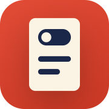

# Offscan



Offscan is an offline document scanner for iPhone and iPad. It turns photos of paper into clean,
flat, searchable PDFs, and it does all of that on the device.

The app was called Flatly until November 2026. Only the name people see changed: the Xcode
project, targets, Swift modules (`FlatlyApp`, `FlatlyCore`) and the on-device storage folder keep
the old name, so existing installs keep their documents.

- **Offline only.** The app contains no networking code and never uploads anything.
- **No ads, no subscriptions, no accounts, no cloud.**
- **Apple frameworks only.** AVFoundation, VisionKit, Vision, Core Image, Core Graphics, PencilKit,
  SwiftData, LocalAuthentication and SwiftUI. There are no third-party dependencies.

## Features

1. **Camera scanning** with Offscan's own camera (live edge outline, auto-capture, many pages per
   session) that keeps the full photo, so a page's edges can be re-adjusted any time. Pages whose
   edges were found are saved straight away (Settings can ask to review every page), pages shot
   at an angle keep their real proportions, Undo removes the last photo and the page sheet lets
   you delete pages or finish scanning without leaving the camera. Apple's document scanner is
   available in Settings ▸ Advanced.
   A **Home Screen quick action** ("Scan Document") opens the camera directly.
2. **Import from Photos or Files**, including **PDFs** (every page becomes a scan page) and
   multi-page TIFFs. Offscan runs its own document detection (Vision document segmentation, then
   rectangle detection as a fallback). You can then fine-tune the four corners by dragging, with
   a magnifying loupe under your finger, or accept every page as detected with **Use All**.
3. **Filters**: Original, Color (auto levels), Grayscale and an adaptive **Black & White** that
   removes shadows and sharpens text, on one page or **all pages** at once. You can also rotate
   and crop each page.
4. **OCR in Polish and English** (Vision, accurate mode), including sideways and upside-down text.
   Recognised text feeds a **searchable library** that ignores case and diacritics, finds words
   hyphenated across lines and lists each result with the matching line (the hit highlighted) and
   its page. The text view rejoins wrapped paragraphs, so you can copy all of it or share readable
   text in one tap.
5. **Export** as a **searchable PDF** with an invisible text layer, or as JPG images. Page size can
   be A4, Letter (the default in US-Letter regions) or Fit to content, and there are three
   compression levels. A PDF can be protected with a **password** (AES-128; never stored by the
   app). Share the result or save it to Files, or use one-tap **Share PDF**.
   Temporary export files are cleaned up automatically.
6. **Library with folders**: rename, move, sort and delete documents, a Recent strip, and a
   **Select** mode to share, move, **merge** or delete several documents at once (selected
   documents are numbered in the order Merge follows). Deleted documents go to **Recently
   Deleted**, where they can be restored for 30 days.
7. **Signatures**: draw one with PencilKit in blue (the default), navy or black ink, keep it for
   one-tap reuse (only when you choose to save or replace it) and place it on any page; it starts
   off the recognised text.
8. **Face ID / Touch ID lock** (the device passcode on devices without biometrics). This is
   optional. The app locks on launch and whenever it goes to the background, covers its content
   in the app switcher, and asks for authentication to turn the lock off.
9. **English and Polish** UI, **dark mode**, **Dynamic Type** and **VoiceOver** labels on every
   control.
10. **Programmatic app icon**, rendered from Swift code (see [Icon](#icon)).

## Requirements

- Xcode 16 or later (Swift 6)
- iOS / iPadOS 17.0 or later
- [XcodeGen](https://github.com/yonaskolb/XcodeGen) (the `.xcodeproj` is generated and is not
  committed)

## Getting started

```sh
brew install xcodegen

# Optional: use your own bundle identifier (default: com.example.flatly)
export BUNDLE_ID_PREFIX=com.yourname.flatly

scripts/generate-project.sh
open Flatly.xcodeproj
```

Then in Xcode select the **FlatlyApp** target, go to *Signing & Capabilities*, choose your
**Team**, and run the `FlatlyApp` scheme on a device or simulator. The document camera needs a
real device; on the simulator you can import from Photos or Files instead.

Never edit `Flatly.xcodeproj` by hand. Change `project.yml` and regenerate.

## Project layout

```
project.yml          XcodeGen spec: the app, the UI tests and FlatlyCore as a local package
FlatlyCore/          Swift package (iOS 17 / macOS 14) holding all the logic
  Imaging/             loading, document detection, perspective correction, filters,
                       rotate/crop, page rendering, thumbnails, PDF page rasterizing
  OCR/                 Vision text recognition (pl-PL, en-US), readable paragraph text
  Export/              searchable PDF and JPEG export, page sizes, compression levels
  Library/             default naming, diacritic-insensitive search and snippets, sorting,
                       ordered selection
  Storage/             per-page image files on disk
  Signature/           PencilKit drawing rendering, compositing and placement
FlatlyApp/           SwiftUI app
  App/                 entry point, root view, dependency wiring
  Persistence/         SwiftData models and DocumentStore (the only place SwiftData is used)
  Features/            Library, Camera, Scan, Import, CornerAdjust, Editor, OCRText, Export,
                       Signature, Settings, Lock
  Services/            ScanProcessor, a background actor that drives FlatlyCore; DocumentAssembler,
                       LibrarySearch, ImageCache
  Resources/           asset catalog, Localizable.xcstrings (en, pl), privacy manifest
FlatlyUITests/       XCUITest smoke tests
Tools/               AppIconGenerator (icon renderer) and Typecheck stubs
TestFixtures/        synthetic document photos + expected.json
scripts/             build, test and generation helpers
```

FlatlyCore does not depend on UIKit, SwiftUI, SwiftData or VisionKit. It works with `CGImage`,
`Data` and `URL`, so it builds and tests on macOS as well as iOS. Every core service is a
`Sendable` struct. The app calls these services off the main actor. Images live on disk per page
as `source` / `original` / `processed` / `thumb` JPEGs. Edits are stored as a non-destructive
render recipe, so you can change filters, rotation and corners later.

[`docs/ARCHITECTURE.md`](docs/ARCHITECTURE.md) is the module contract. It lists the full API,
the processing pipelines and the coordinate conventions.

## Testing

| Command | What it does |
| --- | --- |
| `scripts/test-core.sh` | Builds and runs the FlatlyCore test suite (Swift Testing) on macOS. Works with only the Command Line Tools installed. |
| `scripts/typecheck-app.sh` | Type-checks all FlatlyApp sources against the Mac Catalyst SDK and syntax-checks the UI tests. Use it when Xcode isn't installed. |
| `scripts/check-localization.sh` | Checks that every UI string key is in `Localizable.xcstrings` with a Polish translation, and that no key uses `^[…](inflect: true)` markup (dialog titles show it raw; use plural variations). |
| `scripts/generate-project.sh` | Regenerates the Xcode project. |
| `scripts/check-all.sh` | Runs all of the above and lints the privacy manifest. |

In Xcode, **Product ▸ Test** on the `FlatlyApp` scheme runs both test bundles:

- **FlatlyCoreTests** are the package unit and integration tests.
- **FlatlyUITests** launch the app with `FLATLY_UI_TESTING=1`, which gives an in-memory store with
  the app lock disabled. They check the empty library, the Settings sheet and the add menu.

### Screenshots

`FlatlyUITests/ScreenshotTests` captures every main screen (library, folder, search, document,
page editor, filters, crop, edge adjustment, signature, text, export and its PDF password,
settings and their Advanced section, camera and its Scanned Pages sheet, Recently Deleted, startup
error, empty library). It launches DEBUG builds with
`FLATLY_UI_TESTING=1` and `FLATLY_DEMO_DATA=1`, which seeds a demo library: eight synthetic but
realistic documents in two folders, drawn in the app language (`FlatlyApp/App/Demo/`). In that
mode a demo camera feed (a desk photo with live edge detection) stands in for the camera, so the
simulator shows Offscan's own scanner. `scripts/ui-screenshots.sh` builds for an iPhone simulator once and runs
the tests in English light, English dark and Polish light, writing
`build/screenshots/png/<lang>-<appearance>-<NN-screen>.png`. It needs Xcode.

Without Xcode, let GitHub Actions take them: the `screenshots` job of the iOS build workflow runs
only on demand and uploads the `Offscan-screenshots` artifact (kept 14 days).

```sh
gh workflow run ios-build.yml --ref <branch> -f jobs=screenshots
gh run list --workflow ios-build.yml --branch <branch> --limit 1   # note the run id
gh run watch <run-id> --exit-status
gh run download <run-id> -n Offscan-screenshots -D screenshots
```

The integration tests use the fixtures in `TestFixtures/`: six HEIC photos of invented documents
(no real people or addresses), run through the full pipeline (detect, then correct, then OCR).
`scripts/generate-fixtures.sh` renders them from code: each sheet is projected through a pinhole
camera with a 26 mm-equivalent lens onto a desk, then lit unevenly and given noise.
`TestFixtures/expected.json` lists the words OCR is expected to find in each photo, along with
the sheet's orientation. To test against your own photos as well, put them in
`TestFixtures/private/photos` with a `TestFixtures/private/expected.json` of the same shape;
that folder is git-ignored and the tests pick it up when it exists.

## Privacy

- No network access. The app contains no networking code and does not use CloudKit.
- All data stays in the app's sandbox: the SwiftData store and the page images live in
  *Application Support* (`Flatly/Pages/<page-id>/…`). Documents leave the device only when you
  export or share them yourself.
- No analytics, tracking or crash-reporting SDKs.
- Camera and Face ID are used only for scanning and for the optional app lock. Photo-library
  access is requested only when you save an exported image there. Their usage descriptions are in
  `project.yml`.
- The privacy manifest (`FlatlyApp/Resources/PrivacyInfo.xcprivacy`) declares no tracking and no
  collected data. It lists the two required-reason APIs Offscan uses: UserDefaults for its own
  settings and file timestamps for cleaning up its own page folders.
- When the app lock is on, the app-switcher snapshot shows no document content.

## Icon

The app icon is drawn in code. `Tools/AppIconGenerator` is a small Swift package that uses only
CoreGraphics. To regenerate the icon, run:

```sh
scripts/generate-icon.sh
```

This writes three images to `FlatlyApp/Resources/Assets.xcassets/AppIcon.appiconset/`: the
1024×1024 light icon (`icon-1024.png`) and the dark and tinted variants. All three are opaque.
It also writes a 180×180 rounded preview to `Tools/AppIconGenerator/preview.png`.

The design shows a sheet of paper that is switched off. The background is poppy red. On it sits
a cream sheet with a soft drop shadow. Near its top is a navy toggle with the knob at the left, in
the off position, because the app never goes online. Below are two navy text lines. The shapes
are few and high-contrast, so the icon still reads at home-screen size. The dark variant has a
navy background and a poppy knob. The tinted variant is greyscale on black, so the system can
tint it.

The in-app accent colour is navy (`#263B80`, and `#A9B8F5` in dark mode). Red is left to
destructive actions.

## License

MIT. See [LICENSE](LICENSE).
